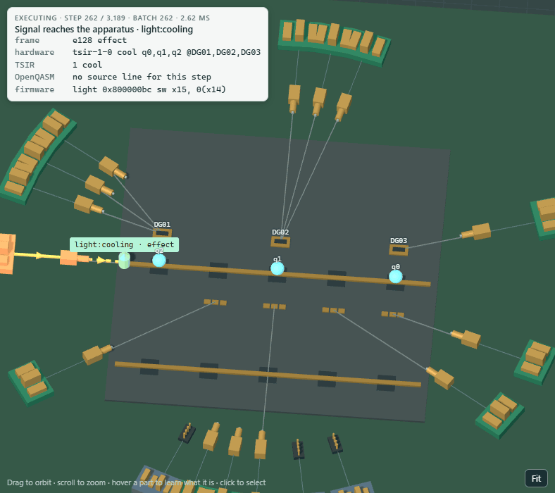
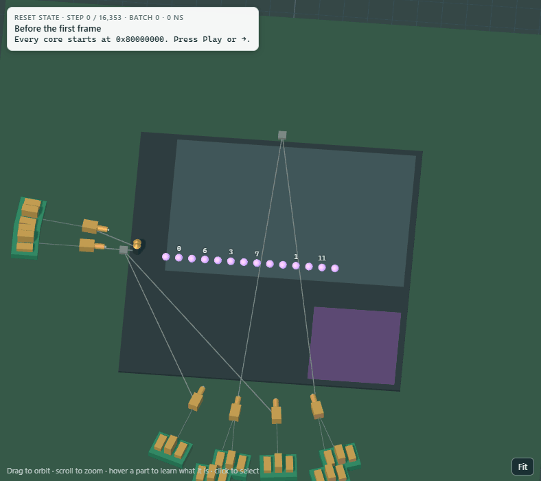
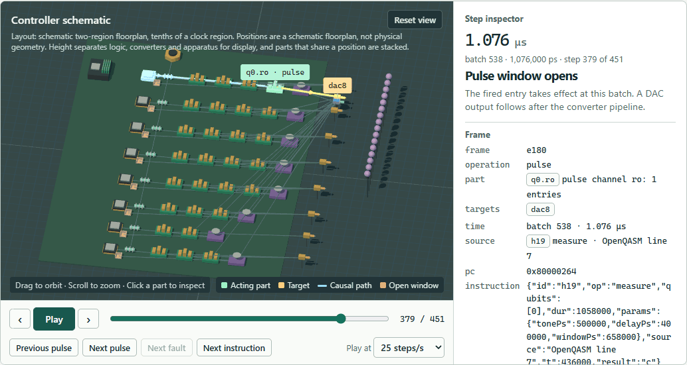
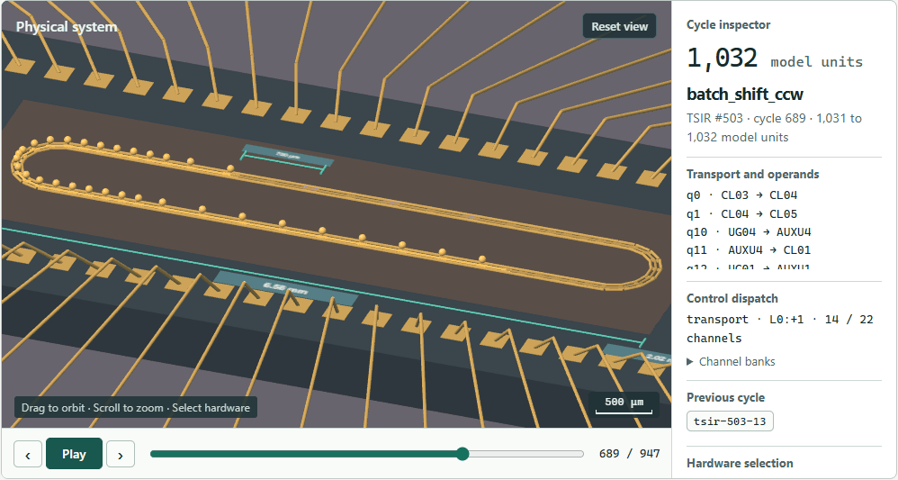
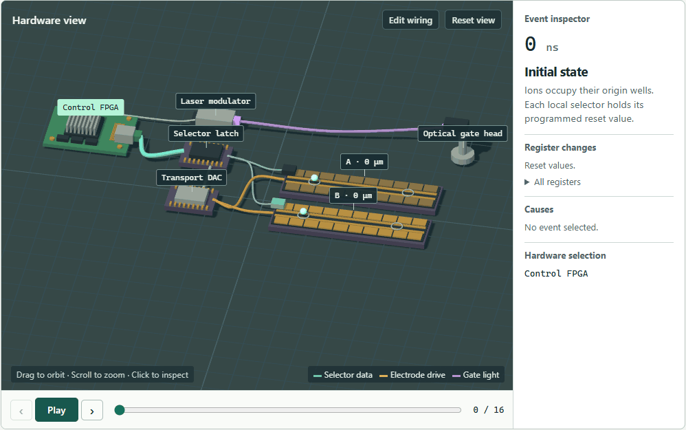
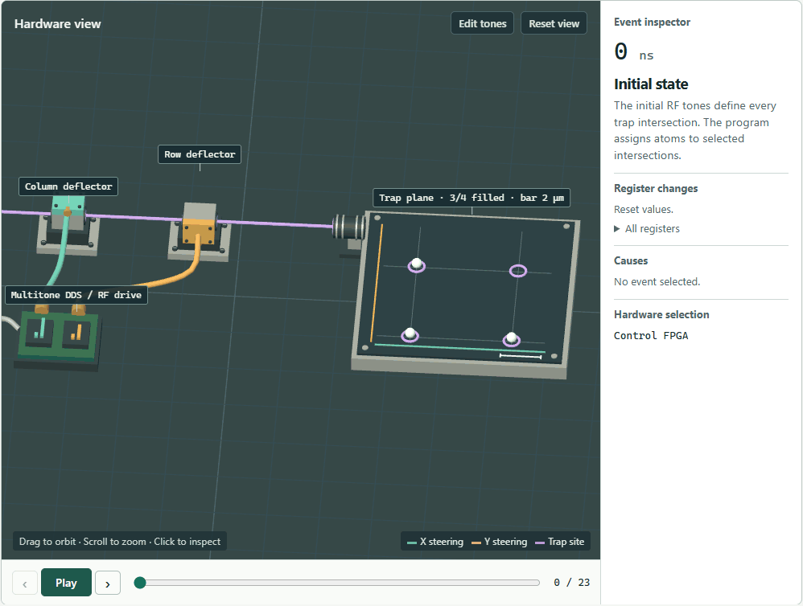
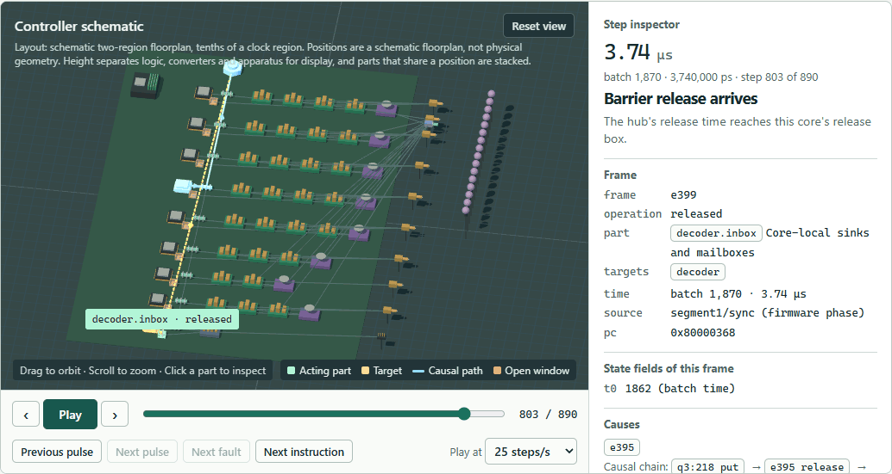
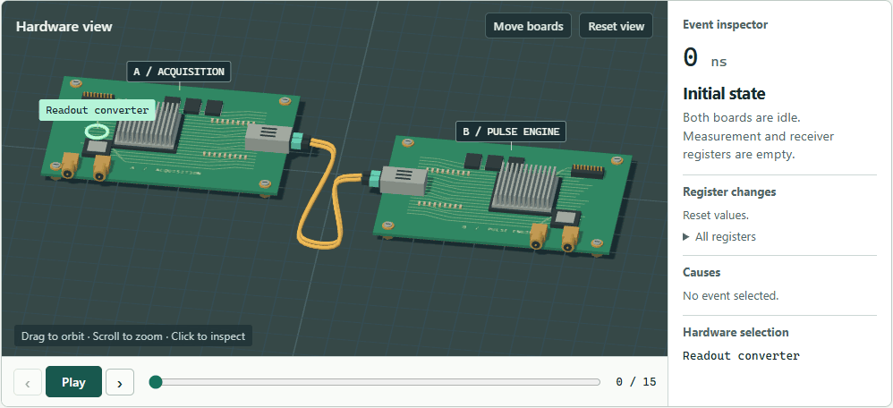

# QControlSys

**A general framework to simulate real quantum computers with control systems.**

Give it a program. It lowers the program to timed hardware operations and to machine code for the control processors,
runs that code in a Lean 4 model of the controller, and lets you step through the result in 3D:
pulses on the wires, ions shuttling through a trap, atoms carried by optical tweezers.



**Trapped ions · a GHZ circuit, end to end.** OpenQASM compiled by [QCCD Studio], lowered to firmware for the control cores around the trap, executed in Lean. Ions shuttle between gate zones while each electrode waveform and laser pulse travels from its core to the trap. Played in machine time: 1 s of the animation is about 87 µs of the machine.

<http://127.0.0.1:7432/riscq-studio?example=qccd-ghz3&outcome=q0=1&outcome=q2=1&view=chip> → **Play**

## What you get

- **Three platforms, one framework.** Superconducting transmons, trapped-ion QCCD machines, neutral-atom arrays.
- **The control system is modelled, not assumed.** Control cores that execute RV32I firmware, links, timed queues, DACs, electrode selectors, AOD tones.
- **Real inputs.** OpenQASM, [QCCD Studio] programs, [ZAC] programs, fault-tolerance system calls, and unmodified [RISC-Q] firmware binaries.
- **Real decoders on the controller.** The C union-find of the [Helios] decoder, compiled for a RISC-V control core, runs and matches Helios's own test vectors.
- **Your hardware, not ours.** Describe a machine as parts, positions and routed wires. Rules are checked, and every wire's length sets when its signal arrives.
- **A debugger for the hardware.** Every step has a stable ID, a part in the 3D scene, its causes and a state you can rebuild. Step forward, step back, click a part.
- **The same run without a browser.** A command line and a JSON API replay the same program and return the same trace, for scripts and agents.
- **Checked, with the limits stated.** Proofs in Lean about the model, conformance tests against RISC-Q and QCCD Studio, comparisons with published measurements.

It simulates the classical control system and the operations it schedules.
No quantum state is simulated. Measurement outcomes are inputs.

## Examples

Start the server ([quick start](#quick-start)), then open the address under a picture.
The animations are photographed from the running app ([how](docs/media/README.md)). The first two play in machine time; the others show one trace step per frame.

### Neutral atoms · a ZAC program on a zoned array



A 14-qubit program compiled by [ZAC]. Two AODs pick atoms up, carry them into the entanglement zone and set them down; the control cores step each AOD tone frequency along the path. Atom positions are read back from the tone frequencies in the trace. 1 s of the animation is 70 µs of the machine.

<http://127.0.0.1:7432/riscq-studio?example=neutral-bv14&view=chip> → **Play**

### Superconducting qubits · feed-forward



An OpenQASM program on a transmon ring. The measured bit leaves q0's readout, crosses the board hub to every control core, and opens the X pulse it conditions on q2.

<http://127.0.0.1:7432/riscq?example=superconducting-feedforward&outcome=c=1>

### Trapped ions · 32 ions around the H2 racetrack



QCCD Studio's 32-qubit GHZ program: the whole register rotates, four ions enter the gate zones, laser pulses address them, single ions shuttle between sites. Physical view, drawn in millimetres.

<http://127.0.0.1:7432/qccd-studio> → **Focus: Trap electrodes and ions** → cycle 689

### Trapped ions · one DAC, many lanes



Two trap lanes share one transport waveform, and each lane's selector decides whether its ion follows. Ion A shuttles 120 µm, ion B holds, then the gate light opens on A. Enlarged working diagram.

<http://127.0.0.1:7432/qccd> → **Debugger detail**

### Neutral atoms · crossed AOD tones



Two crossed acousto-optic deflectors (AODs) place the tweezers. Stepping a column tone carries both atoms on that column, 500 nm per step. A row tone then moves its whole row, empty trap included. Enlarged working diagram.

<http://127.0.0.1:7432/neutral> → **Debugger detail**

### Fault tolerance · a decoder core and a Pauli frame



A repetition-code round written as system calls. The decoder core reads two syndrome bits from the board hub, looks up the correction and records a Pauli-frame update. No pulse is played.

<http://127.0.0.1:7432/riscq?example=superconducting-repetition&outcome=s0=1&step=803>

### Classical control · two-board feed-forward



Board A digitizes a readout and sends two bits over fiber. Board B samples them on its clock edge, reads waveform memory and drives the RF pulse.

<http://127.0.0.1:7432/feedforward>

### Also runnable

```sh
node riscq/cli.mjs --example decoder-helios-d3                 # Helios union-find, compiled C on a control core
node riscq/cli.mjs --ring-design > machine.json                # a machine as an editable design document
node riscq/cli.mjs --design machine.json --qasm circuit.qasm   # run a program on your design
```

<!-- More examples go here. Copy a block above: heading, GIF, one caption line, one address or command.
     Add the GIF as a scene in docs/media/capture.mjs and rebuild it by name. -->

<a id="run-the-studio"></a>

## Quick start

```sh
npm ci
npm start        # builds the Lean model, then serves http://127.0.0.1:7432
```

- Needs Node.js with npm and Lean's [Elan](https://github.com/leanprover/elan) toolchain manager.
- The QCCD Studio examples also need Python 3.10+ and the [QCCD Studio] compiler branch in a sibling folder named `QCCD`.
- Without a browser, after `npm start` or `lake build`:

```sh
node riscq/cli.mjs --list
node riscq/cli.mjs --example superconducting-feedforward --outcome c=1 --out run.json
```

Pages: `/` machine workbench · `/riscq-studio` RISC-Q workspace · `/riscq` controller debugger · `/qccd-studio` · `/qccd` · `/neutral` · `/feedforward` · `/controller` · `/validation` · `/board-validation`

## How it works

| Level | What it is |
| --- | --- |
| 1. Source | OpenQASM, a QCCD Studio program, a ZAC program, or a list of fault-tolerance system calls |
| 2. Hardware instructions | Timed physical operations: pulses, ion shuttles, AOD moves |
| 3. Firmware | RV32I machine code for [RISC-Q] control cores |
| 4. Execution | A Lean 4 model of the controller runs the firmware and emits a trace |
| 5. Debugger | The browser steps through the trace. Scene, plots and inspector are derived from it |

- This chain is the controller debugger at `/riscq`, for all three platforms.
- `/qccd`, `/neutral`, `/feedforward` and `/controller` work the same way on their own programs: the Lean model executes, the page replays the trace.
- `/qccd-studio` replays QCCD Studio's own execution, and Lean checks every ion placement.

## What is verified

- **Proved in Lean, about the model.** For example, a register write issued early enough lands exactly on its start time ([`land_exact`](QControl/RiscQ/Timing.lean)).
- **Tested against other people's artifacts.** Three unmodified RISC-Q firmware binaries reproduce what RISC-Q's RTL simulations assert. The H2 replay is compared with QCCD Studio's own viewer on all 947 cycles.
- **Not hardware measurements.** Timings are results of the model, with published values where a program states none ([sources](riscq/standards.mjs)). The controller scene is a schematic floorplan.

[What is proved, what is tested, what is assumed](docs/riscq-controller.md#what-is-proved-what-is-tested-what-is-assumed)

## Documents

- [Studio guide](docs/studio-guide.md): every bench step by step, the Lean model, headless use. This was the README.
- [RISC-Q controller model](docs/riscq-controller.md): lowering paths, register map, latencies, proofs, tests, first measurements
- [Machine workbench](docs/component-machines.md): machine format, source languages, timing semantics
- [Waveform controller](docs/controller-fidelity.md): fidelity, assumptions, a worked experiment
- [Hardware validation](docs/physical-validation.md) · [Board measurements](docs/board-validation.md) · [Capture format](docs/controller-capture.md)
- [Literature review](docs/literature-review.md) · [Architecture and development plan](docs/development-plan.md)
- [Development rule](AGENTS.md) · [How the animations are made](docs/media/README.md)

[QCCD Studio]: https://github.com/yezhuoyang/QCCD/tree/compiler
[ZAC]: https://github.com/UCLA-VAST/ZAC
[RISC-Q]: https://github.com/Wu-Quantum-Application-System-Group/RISC-Q
[Helios]: https://github.com/NamiLiy/Helios_scalable_QEC
