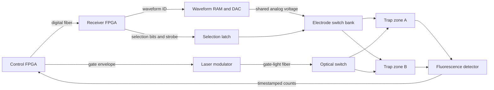

# QControlSys architecture and development plan

Proposal · 22 November 2026 · [Literature review and experimental evidence](literature-review.md)

**Implementation status.** The [working benches](../README.md#run-the-studio) cover two-board feed-forward, programmable QCCD broadcasting and crossed-AOD neutral-atom steering. QCCD and neutral-atom programs expose metric installations with connected electronics and quantum devices. The H2 import compares all 947 GHZ32 cycles against the native Studio representation and offers a native editor handoff. A [separate waveform controller](controller-fidelity.md) executes an instruction program, finite-width DMA bus with scheduled grants, FIFO and sampled DAC path. The [physical validation suite](physical-validation.md) now runs reconstructed hardware commands against held-out data for all three modalities and reports failures alongside successful comparisons. It also connects native ZAC movement records, a native Quantum Metal design and QCCD Studio to the reference views. Remaining work includes multi-master arbitration, synchronized device-specific electronics captures, a mapping from Studio commands to the sampled controller, general port composition, and neutral-atom image-conditioned rearrangement and loss.

**Build one deterministic simulator for the classical control system.** A hardware design connects clocks, FPGAs, memories, wires, buses, converters, sensors and actuators. A qubit modality supplies the equipment attached to those ports and the rules by which a delivered signal moves, drives or measures a qubit. Begin with a two-board measurement-to-pulse benchmark. It has published scope data, exercises the common hardware, and can run with an emulated readout before a quantum device model exists. [QubiC two-board experiment, figure 3](https://arxiv.org/html/2506.09856v1)

The first release should answer three questions for a design drawn in the browser. **Which physical outputs occurred, and when? Which component or shared resource determined that outcome? Would a proposed change still run the same fault-tolerant workload correctly?** Every answer should point to a trace, an explicit assumption, or a check that another person or agent can rerun.

## What to reuse from QCCD Studio

The team's neighboring QCCD Studio checkout inspected at revision `9ce920b` already has a device format, a physical instruction format (TSIR), a checker, and a shared edit protocol for people and agents. Its H2 reproduction includes a machine and a compiled GHZ program. The nested QCCD3dArtifact checkout at `cc8d5c5` contains planar and stacked scheduling studies, shared waveform assignments and receiver constraints. These are practical inputs for the new simulator. Their timings are architectural model results. [Studio workspace](https://github.com/yezhuoyang/QCCD/blob/compiler/docs/workspace.md) · [H2 reproduction and fixtures](https://github.com/yezhuoyang/QCCD/tree/compiler/Reproduce/moses2023) · [QCCD3dArtifact](https://github.com/yezhuoyang/QCCD3dArtifact)

Import `h2.arch.json` and `demo/ghz32.tsir.json` as a named pair. Map sites, ions, waveform groups and instruction IDs to stable local IDs. The fixture's primitive durations are normalized unit times. Use it to validate operations and wiring. Supply missing electronics and physical timing in a separate controller profile and list every assumption introduced by the adapter. In the timing profile shared with Studio, compare occupants, ordering, destinations and gate eligibility at instruction boundaries. With explicit electronics enabled, split the time difference into issue, transfer, selection, settling and contention. Surface unsupported instructions and unavailable calibration as structured diagnostics. Keep the upstream design, program and checker verdict bound to their original versions. [Studio compiler and checker boundary](https://github.com/yezhuoyang/QCCD/tree/compiler/Compiler)

## One machine description and one execution model

| Artifact | Required contents | Used by |
| --- | --- | --- |
| Machine | Hierarchical component instances, typed ports, clock domains, memory map, arbitration, physical routes and coordinate systems. A cable has a physical length or a specified delay. A change in drawing coordinates affects propagation only when the route is declared geometry-derived. | Editor, validator, scheduler, 3D view |
| Control program | Timed or conditional operations, dependencies and deadlines. Initial verbs cover load/store, DMA, wait/trigger, play, acquire, compare/branch, broadcast/select and barriers. A lowering pass maps a modality operation to a bundle of these instructions with source IDs. | Compiler adapters, sequencer, debugger |
| Device and calibration profile | Waveform bank, response curves, operating ranges, calibration date, uncertainty, and provenance for each measured, specified, fitted or assumed value. Store hashes of external assets. | Component models, validator, experiment reports |
| Run manifest and trace | Input hashes, engine and model versions, fidelity per component, random stream definitions, initial state, external inputs, event records and checkpoint index. | Replay, comparison, browser and agent queries |

**Timing.** Start from an exact reference time representation. Clock domains carry a rational period, phase and local edge counter. A run can use integer ticks when its clocks and deadlines admit an exact common unit. Validate resolution and check for overflow before execution. An event has a physical time and a microstep for zero-duration causal work. At a clock edge, blocks sample the defined pre-edge state, resolve arbitration using the declared policy, then commit and publish outputs. Model asynchronous crossings with a synchronizer or asynchronous FIFO and a declared phase/uncertainty model. A zero-delay cycle without defined settling semantics is rejected. Serialization order for independent events has no physical effect. [Ptolemy discrete-event semantics](https://ptolemy.berkeley.edu/publications/papers/99/deModeling/) · [ARTIQ timing](https://m-labs.hk/artiq/manual/rtio.html)

**Components.** Each component declares its ports, state, parameters, preconditions, transition function, output events, occupied resources and next wake-up. Quantum state is optional. An ordinary sensor → FPGA → actuator loop must run with the same kernel. Recommended implementation is a small reference interpreter and independent trace checker first, followed by a Rust execution kernel that can run natively and in a browser worker via WebAssembly. Python can supply adapters and calibration tools, and TypeScript can implement the editor and 3D viewer. Gate that choice on desktop/browser trace parity and profiling in milestone 1.

### Classical component library

| Family | First executable model | Fidelity that can be selected later |
| --- | --- | --- |
| FPGA and clocks | Timed instruction issue, register and waveform banks, branch latency, per-channel command FIFOs, fixed pipeline latency and initiation interval, trigger fan-out, reset and clock alignment | Selected cycle/bit-accurate RTL blocks, fixed-point DSP, bounded clock drift and jitter, FPGA resource counts from synthesis reports |
| Memory and interconnect | Dual-port block RAM with declared read-during-write policy, finite DDR capacity and transaction service time, DMA descriptors and bursts, bus width, arbitration, outstanding requests, backpressure | Bank, row and refresh timing, separate read/write response paths, and trace comparison with Ramulator and RTL |
| Wires, clocks and optical links | Digital copper trigger, clock distribution, framed serial link over copper/fiber, analog coax, optical splitter/switch, typed transducers. Model delivery skew, fan-out and contention where appropriate | Measured impulse responses, attenuation, crosstalk, transceiver pipelines, phase noise, link interruption and resynchronization |
| Signal generation and acquisition | Waveform cache, numerically controlled oscillator, DAC/ADC, mixer, sampled envelope, integration window and discriminator | Fixed-point rounding, clipping, quantization, FIR/IIR response, calibrated noise and local sample-level probes |
| Sensors, host and feedback | Timestamped samples or image regions, readout-to-bit conversion, host uploads, streaming decoder service, conditional issue | Per-stage service distributions, batched transfers, correlated data-dependent service times and real decoder adapters |

Model a store-and-forward digital hop as queueing + serialization of *on-wire* bits + propagation + receiver pipeline. Define when first and last bits are observable. For streaming or cut-through hops, allow overlapping service and account for it on the event graph. Use measured end-to-end delays as a single aggregate when the component breakdown is unknown. For analog coax or coherent optical delivery, propagate a delayed complex envelope through calibrated gain, filtering and phase. A digital fiber delivers frames to a transceiver. The downstream controller can buffer waveform samples or look up a waveform ID and drive a DAC. A gate-light fiber terminates in optics at the device. An analog RF-over-fiber design explicitly inserts a modulator and photoreceiver. Both the editor and type checker should expose those endpoints. [QubiC digital fiber](https://arxiv.org/html/2506.09856v1) · [QCCD optical delivery](https://arxiv.org/abs/2401.18056)

For a concrete design sweep, suppose a remote board plays eight independent real-valued channels at 250 million samples/s and 16 bits/sample. Continuous raw playback consumes **32 Gbit/s** before framing. A 10 Gbit/s link cannot sustain that stream. Preloading repeated waveforms and sending timestamped identifiers trades link traffic for remote memory, read bandwidth and a cache-miss deadline. Test all three limits by varying waveform reuse and buffer depth. These figures are illustrative design inputs.

The proposed QCCD bench has two physical paths to the same zone. A probe on the digital receiver can explain a missed selection deadline. A probe at the optical output can explain a late gate pulse even when the electrode command arrived on time.

## Three physical device models

| Device | Command-to-device path | State, checks and observables |
| --- | --- | --- |
| Superconducting | Sequencer → waveform RAM/NCO → DAC → direct RF or IQ mixer → attenuated/filtered drive or flux line → fixed transmon or coupler. Readout resonator → shared feedline and amplifier → ADC → downconversion/integration → discriminator → branch. | Frame/phase, line delay and distortion, channel occupancy, resonator ring-up/down, multiplexed bandwidth and amplifier headroom. Expose delivered IQ, integrals, classification, leakage estimate and pulse onset. Begin with conditional reset and then add repeated parity measurement. [QICK](https://arxiv.org/abs/2110.00557) · [Cryoscope](https://arxiv.org/abs/1907.04818) |
| Neutral atom | FPGA/DMA → waveform playback or per-tone synthesis → DAC/RF amplifier → crossed AODs → mobile tweezer grid alongside SLM traps. Imaging → camera exposure and region readout → classifier → occupancy map → rearrangement or conditional gate. | Each tone has frequency, amplitude and phase. Map delivered frequency through a measured spot-position curve. Include acoustic transit across the illuminated aperture, settling, RF and optical power limits, unintended intersections, row/column movement, pickup/release, and loss. For gates check zone, occupancy and blockade geometry. Expose commanded spot, achieved trap position and atom position separately. [Crossed-AOD experiment](https://arxiv.org/abs/2312.03982) · [Streaming rearrangement](https://pmc.ncbi.nlm.nih.gov/articles/PMC12571880/) |
| Trapped-ion QCCD | FPGA → digital link → remote waveform memory and selector → DAC/filter → cowired electrode group → transport, split, merge or junction crossing. A separate laser/modulator → fiber/switch → gate or detection zone. Fluorescence detector → counts → classified result. | Track each crystal's ordered ions, location, site capacity, motional excitation and cooling. A broadcast acts on every physically connected recipient according to its latched selection. Track driver ownership, selector setup, waveform compatibility, arrival/settling and optical access. Separate fixed wiring, per-site switching and conditional swap-or-stay profiles. [H2](https://doi.org/10.1103/PhysRevX.13.041052) · [Conditional exchange](https://arxiv.org/abs/2403.00756) · [Optical zones](https://arxiv.org/abs/2401.18056) |

Start physical motion with calibrated trajectory segments and duration-, distance- and operating-point-dependent error bounds. For a selected neutral-atom move, integrate a particle in a moving harmonic trap to estimate lag or excitation. For a selected ion waveform, a precomputed electrode basis can map delivered voltages to a local potential minimum and curvature along a path. For a selected superconducting pulse, integrate a small driven transmon/resonator model. Record where a fit is valid, and mark out-of-range outputs as extrapolations. These refinements allow quantitative tests at the device without a full electromagnetic field solve.

## Scalable fault-tolerant workloads

Use a deterministic scripted measurement source for control-flow tests. For quantum-aware runs, let a compatible stabilizer/Pauli-frame backend produce measurement outcomes from *executed* operations. Preserve ordering, measurement identities, and heralded loss/erasure metadata. Add explicit leakage/loss state or a calibrated channel where the backend's native representation is insufficient. Local non-Clifford or analog studies can use a small dynamics model. Each run must declare which observables its backend supports. [Stim](https://arxiv.org/abs/2103.02202) · [Zoned neutral-atom fault-tolerance experiments](https://pmc.ncbi.nlm.nih.gov/articles/PMC12727508/)

Across modalities, acquisition and classification produce timestamped syndrome or erasure bits. The control system routes and buffers them until the decoder can issue a frame update or authorize a conditional operation. Frame dependencies have a latest-consumption time. Score sustained syndrome throughput, backlog slope, buffer high-water mark, lost results, deadline misses, and the latency distribution from final usable input to dependent actuation. Include p50, p99 and worst observed for a stated number of rounds. Track logical error per round only for a specified code, decoder, noise model and sample count, with uncertainty. Timing feasibility and logical performance require separate evidence. [Google Quantum AI](https://arxiv.org/abs/2408.13687) · [Caune et al.](https://www.nature.com/articles/s41467-026-73331-6)

**Fidelity and scale.** The default engine schedules transactions, waveform segments and resource claims. Detailed mode expands only selected components and time windows into cycles or samples, starting from a checkpoint that includes filter, oscillator and queue history. Preserve stalls, deadlines, clock alignment and effects visible outside the window. Batch repeated rounds only up to an observable branch, contention change or feedback dependency. Use shared waveform definitions, sparse activity, streaming counters, and indexed trace chunks. Render a spatial or temporal subset for the browser. Benchmark simulated time, host wall time, peak memory, event count and trace bytes separately.

## Browser design, 3D visualization and debugging

* **Compose.** Drag a board, memory bank, clock source, transceiver, AOD, trap zone or readout chain from a palette. Connect compatible typed ports, group components into a reusable module, edit parameters with units, and save/load a versioned design. A proposed invalid connection names the two ports and the conversion hardware needed. Import a Studio machine and overlay its wiring. Support undo, redo, and comparing two revisions on the same workload.
* **See the physical hierarchy.** Navigate rack → board → port → device. Use explicit scale changes between meters of cable and micrometers of qubit travel. A superconducting chip shows fixed qubits and active lines. An atom array shows crossed beams, occupied traps and moving atoms. A QCCD shows electrode groups, all broadcast recipients, chain order and optical zones. The drawing carries physical units and identifies abstract routes. Clicking any object selects the same ID in the schematic, trace and program.
* **Debug a causal chain.** Step by event, active clock edge, instruction, movement or QEC round. Break on FIFO full, stale selector, underflow, lost atom, invalid broadcast or missed deadline. Show a timeline with requested, accepted and delivered times, synchronized 3D state, waveforms at named probes, memory/register values and causal predecessors. Step back by loading a checkpoint and replaying logged inputs. Changing an input makes a new run from the divergence point and recomputes downstream decisions.
* **Acceptance walkthrough.** Drag in a second receiver, connect it to a shared DAC group, delay its selection word, then step to the next strobe. The 3D view should highlight both recipients, the trace should identify the selector value sampled at each, and the inspector should explain the observed movement. Restoring the setup margin should change that outcome at a named event. The command line and an agent must be able to reproduce both runs from the saved files.

## Formalization and agent access

Define each component as a function from typed inputs, prior state and explicit environmental choices to next state, outputs and resource claims. The reference semantics defines event composition, clocks, memory visibility, simultaneous arbitration, random draws and failures. Each component profile ships with a machine-readable contract, units/ranges, examples, and a conformance check. A hardware measurement can establish a parameter range. A theorem can establish behavior conditional on that range. Report separately whether an obligation is proved, checked for this trace, calibrated against data, or still open. [QCCDCert's checker approach](https://arxiv.org/abs/2611.23469)

| Boundary | First obligation | Evidence to produce |
| --- | --- | --- |
| Design changes and interfaces | Well-typed links, unique IDs, valid units and revisions. Applying and undoing an accepted edit restores the canonical semantic document. | Schema and edit interpreter, round-trip and conflicting-edit fixtures |
| Kernel and digital components | Time is monotone, independent events commute, a stalled FIFO preserves data, reads see the declared write, and exclusive resources have at most one owner. | Executable reference, short finite-state checks, then Lean proofs beginning with the event step and FIFO |
| Compiler and modality adapters | Projecting a detailed trace to source-operation boundaries preserves supported ordering, recipients, movement and decision dependencies within stated timing bounds. | Mapping witness and standalone checker that identifies the source ID and first mismatching event |
| Analog and stochastic models | Parameter units, validity domains, stated numerical error and deterministic replay with recorded choices. An empirical accuracy claim has an independent trace or an uncertainty interval. | Reference evaluation, convergence or interval checks, calibration and held-out validation records |
| 3D UI and agent operations | Scene objects are projections of state at the selected time. A click, drag, or agent patch has a defined selection or document effect. Export, import and replay preserve semantics. | Scene-data snapshots, browser/CLI parity, UI acceptance tests, versioned command schema |

Expose revision-aware operations to people and agents through one API. Suggested operations are `inspect_design`, `apply_patch(base_revision, operations)`, `validate`, `run`, `step`, `query_trace`, `explain_event`, and `compare_runs`. Supply stable IDs, structured errors, units, model coverage, causality and pagination. A browser selection can anchor the agent's context to a component, physical region, program instruction or trace window. Agent experiments run on a fork with fixed workload, scoring profile and calibration digest. An independent checker recomputes the verdict under the pinned profile. A stale edit returns the intervening revision so the agent can rebase. Reuse the QCCD workspace revision and change-set conventions where their semantics match. [QCCD Studio agent workflow](https://qccd.academy/agentic/)

## Implementation sequence and exit tests

The milestones specify a dependency order. Staffing and access to bench measurements will determine calendar dates. A milestone closes on its observable exit test.

| Milestone | Deliverable | Exit test |
| --- | --- | --- |
| 0 · Boundaries and reference fixtures | Machine/program/trace vocabulary, calibration format, two-board diagram, scope timing boundaries, tiny QCCD import sample, minimal atom rearrangement schedule | Hand-work one success and one failure for each fixture. Define expected event order, units, observable endpoints and source provenance before coding the models. |
| 1 · Shared classical kernel | Headless interpreter, clocks, FPGA issue/branch, RAM, DMA, explicit backpressure, fiber link, deterministic measurement source, checkpoint/replay | Reproduce the two-board figure's branches and nominal pulse timing. Inject a delayed result, saturate a FIFO, and phase-shift the clocks. Match an independently derived edge trace and reproduce the same first failure after rewind. |
| 2 · Studio and first QCCD device | Browser drag/compose, shared edit API, rack-to-device 3D view, linked program/timeline and agent trace queries. Add remote waveform selection, shared electrodes and an independently switched optical path. | Pass the two-receiver walkthrough. Import the H2 program and compare projected movement/gate order with Studio. A manual edit and equivalent agent edit yield the same canonical design and trace. |
| 3 · Superconducting and neutral-atom devices | Multiplexed readout and conditional reset for superconducting qubits. Crossed AODs, static/mobile handoff, image-conditioned rearrangement and zone-sensitive gates. Add local waveform probes. | Recreate the QICK loopback configuration change and an atom readout-to-conditional-output sequence. Induce a shared readout resource stall and an illegal AOD row crossing. Expose the earliest cause in the debugger. |
| 4 · Fault-tolerant control loop | Decoder service and external decoder adapter, deferred frame updates, repeated syndrome acquisition, loss/erasure events, and one genuinely dependent physical branch per modality | Show sustained service and then backlog under a controlled overload. Hold average throughput constant while increasing response latency and demonstrate the effect on a dependent operation. Independently check eligible stabilizer outcomes and frame updates. |
| 5 · Fidelity, proofs and scale | Selected RTL/DSP comparisons, measured response imports, conservative event batching, long-run metrics, standalone trace checker and initial machine-checked properties | Pass the validation gates below. Publish the supported component and proof coverage with a reproducible run manifest and measured performance on a named machine. |

### Validation gates

1. **Digital correctness.** Compare small adversarial traces against hand calculations or RTL. Require exact agreement on the specified edge for handshakes, branch bits, commits and recipients. Include coincident edges, reset during transfer, concurrent reads/writes, a full FIFO and a late broadcast mask. Run the same design and seed headlessly and through the browser. Compare canonical events and quantized observables across both builds.
2. **Physical accuracy.** Start a profile from a named experiment. Fit on one capture and evaluate another operating point or withheld capture. Record timing residuals, normalized waveform error, position error and measurement classification statistics as applicable. Set acceptance bounds from sample spacing, measurement uncertainty and the intended decision, before fitting. A published approximate figure supports a consistency check at the precision of that figure. Validating internal stages requires separate observations.
3. **Fault-tolerant behavior.** Use a distance-three memory workload as a small oracle, then a workload with a decoded logical branch. Vary decoder service and link latency independently. Check missing or delayed syndromes, Pauli-frame consumption and conditional gate ordering. Compare modalities with the same logical question and disclose code, placement, physical schedule, noise and timing assumptions for each instance.
4. **Scaling.** As proposed benchmark sizes, sweep 1, 16 and 256 boards, and run up to one million repeated rounds in summary mode. Use separate stress tests for a 1,000-site moving array and a long waveform with a short sampled probe. Measure peak memory, events per round, wall time and trace bytes with and without recording. Cross-check shortened runs against fully expanded traces and verify that inactive channels and unobserved carrier samples do not dominate cost. Set release performance targets after measuring the first implementation.

**First implementation task.** Freeze the two-board benchmark's machine diagram, timing boundaries and expected outcomes. In the published example, the two measurement bits select zero, one, two or three remote pulses. Check all four input patterns, then compare the onset time for the emitting cases with figure 3. Add a separate synthetic case that delivers the last required bit one receiver edge too late. Specify whether the modeled board faults, waits or uses a previously latched value, and derive the expected event trace independently. Those traces give the kernel, debugger, browser and agent API a common definition of a correct first run. [QubiC listing 1 and figure 3](https://arxiv.org/html/2506.09856v1)
